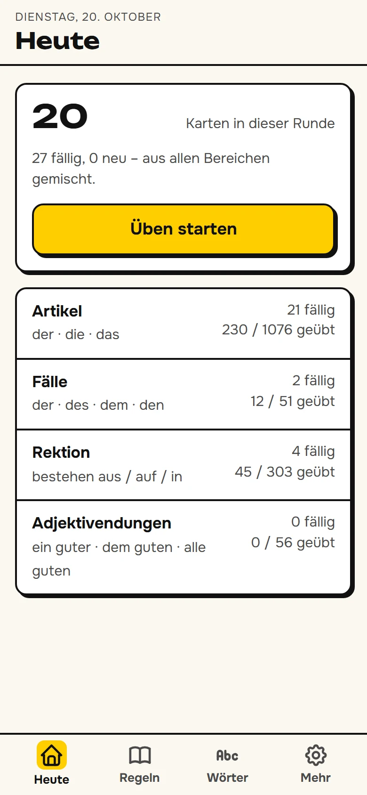
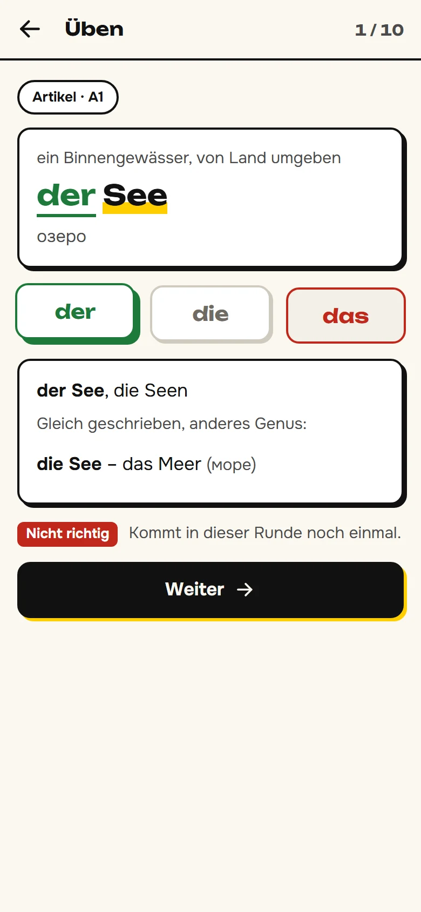
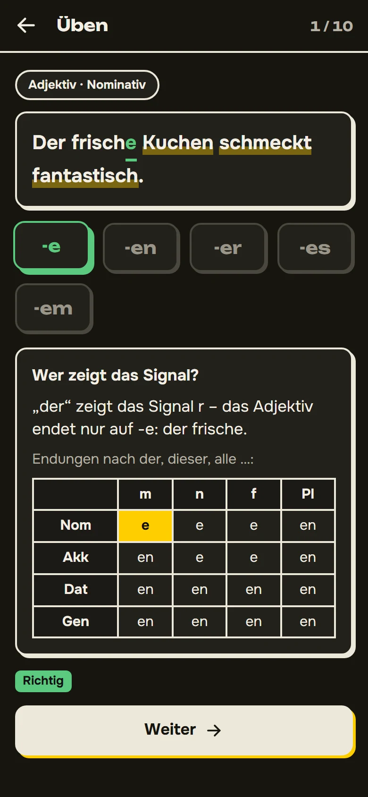
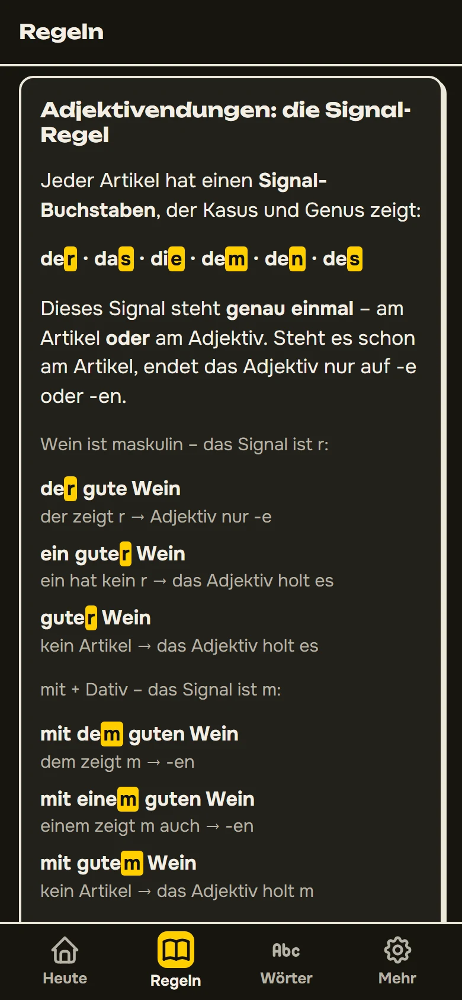
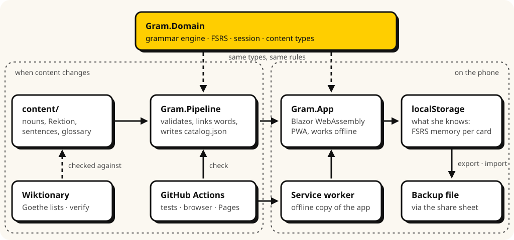

# Fallstrick

*German grammar's traps – practised until they stop being traps.*

[](https://github.com/temvarin/fallstrick/actions/workflows/ci.yml)
[](LICENSE.md)

A practice app for the parts of German that stay hard long after the rest is fluent: noun genders (*der, die, das*), the article in the four cases (*der – des – dem – den*), verbs, adjectives and nouns with fixed prepositions (*Rektion*: *bestehen aus / auf / in*), and adjective endings (*ein guter, dem guten, alle guten*). It is an offline-capable web app (PWA) built with Blazor WebAssembly and a .NET content pipeline, with explanations in German and a Russian translation for every word one tap away.

**[Open the app →](https://temvarin.github.io/fallstrick/)** – and add it to your home screen to use it like an installed app ([how](#install-on-a-phone)).

| Today | Articles | Adjective endings | Rules |
|:---:|:---:|:---:|:---:|
|  |  |  |  |

## Why

Advanced learners speak and read German well and still say *das Teil* when they mean *der Teil*, *bestehen auf* for *bestehen aus*, or *mit einem guten Freund* only after a pause. These are small, closed systems that no amount of reading fixes on its own: they have to be retrieved, many times, spread over weeks.

The app is built on what learning research supports rather than on what looks engaging:

- **Every card asks for the answer** instead of showing it, and always gives feedback – retrieval with feedback is the most reliable way to remember (Dunlosky et al., 2013; Rowland, 2014).
- **Spaced repetition with FSRS**, the scheduler modern Anki uses; reviews come back just before they would be forgotten (Cepeda et al., 2008; for second languages Kim & Webb, 2022).
- **Mixed sessions:** all four areas in one round, and confusable items (*der/das Teil*, *bestehen aus/auf/in*) never back to back, so the difference has to be worked out each time (Brunmair & Richter, 2019; Nakata & Suzuki, 2019).
- **A hint before the answer:** where a second try is more than a coin flip, a wrong answer earns a nudge and one more try; then the answer and its rule (Li, 2010; Lyster & Saito, 2010).
- **Rektion as whole chunks in sentences**, typed, not matched in a grid – matching exercises leave wrong pairings behind (Boers et al., 2014).
- **Nouns always with their article**, from the first encounter (Arnon & Ramscar, 2012).
- **Explanations without jargon:** adjective endings are explained by one question – *who shows the signal, the article or the adjective?* – instead of “strong, weak, mixed”.

Left out on purpose: colour-coding genders (no solid evidence, and colour here only ever means right or wrong) and multiple choice as the main format.

## Features

- **Four areas:** nearly 1,100 nouns from A2 to C1 (with nouns whose gender changes the meaning, like *der/die See*), the article in all cases plus *who does what* sentences where only the article tells (*Den Lehrer sieht der Schüler*), 300 Rektion entries in 43 groups of confusable prepositions, and adjective endings for every cell of the table and after *alle, viele, beide …*.
- **Explanations after every answer:** the gender rule a noun follows or breaks, the case and why, the declension table with the cell highlighted, the other prepositions of the same verb.
- **Rules pages:** article tables, the signal rule with examples, and the noun endings that predict gender – marked as reliable or only usually right.
- **Russian help:** every word in a sentence can be tapped for its dictionary form and Russian translation; the word list searches German and Russian.
- **Works offline**, installs to the home screen, follows dark mode. No account, no tracking: progress stays in the browser, with a backup file to move it to a new phone.

## Install on a phone

- **iPhone:** open the app in **Safari** → Share → *Add to Home Screen*.
- **Android:** open the app in **Chrome** → ⋮ menu → *Add to Home screen* → *Install*.

Then open it once while online so everything is cached for offline use. Updates arrive in the background and take effect the next time the app is opened after being closed.

## Engineering highlights

- **A grammar engine instead of stored answers.** Article forms and adjective endings are computed by `Gram.Domain.Grammar` from the standard paradigms; the content only says which determiner, case and gender a sentence has. Tests reproduce every cell of the article and adjective tables (Duden, *Die Grammatik*).
- **FSRS, verified against the reference.** The scheduler is a port of [py-fsrs](https://github.com/open-spaced-repetition/py-fsrs); its tests compare intervals, stability and difficulty with values computed by py-fsrs itself, to four decimals.
- **Content is validated like code.** The pipeline rejects content that would teach something wrong: a hint that gives away its answer, a sentence whose case doesn't match its reason (*mit + Dativ*), a fixed-case preposition with the other case, a noun after the gap with the wrong gender. CI fails if the committed data differs from what the sources produce.
- **Checked against outside sources.** `verify` compares every noun's gender and plural with Wiktionary and every level claim with the Goethe word lists, locally; the sources of each entry are recorded.
- **Browser tests in CI.** Playwright drives the published app: a full session, tap-to-translate, an offline reload through the service worker, a backup round-trip – and axe checks every page for accessibility violations.
- **One domain, two consumers.** The pipeline writes the data with the same types the app reads it with; a test reads the JSON the pipeline writes with the app's source-generated reader.
- **Deterministic tests.** Clock (`TimeProvider`) and randomness are injected: xUnit for the domain and pipeline, bUnit for components, Playwright for the whole app.
- **Trimming-safe and lean.** Source-generated JSON, no ICU culture data, self-hosted fonts subset to Latin and Cyrillic.
- **Strict build.** .NET analyzers at the recommended level, warnings are errors, the SDK version pinned in `global.json`.

## Architecture

One .NET 10 solution: a Blazor WebAssembly app and a content pipeline that share a domain library.

<picture>
  <source media="(prefers-color-scheme: dark)" srcset="docs/diagrams/architecture-dark.svg">
  
</picture>

- **Gram.Domain** (`src/Gram.Domain`): the grammar engine (articles, adjective endings, the signal rule), the content types, cards and exercises with their hints and explanations, FSRS, the practice session and stored progress with a schema version. No UI, no I/O.
- **Gram.Pipeline** (`src/Gram.Pipeline`): validates the sources, links every word in a sentence to its translation, writes `catalog.json`; `check` (CI), `words` (untranslated words) and `verify` (outside sources, local only).
- **Gram.App** (`src/Gram.App`): Razor components on top of the domain – one component per exercise type, the answer flow on the practice page.

### Repository layout

```
src/
  Gram.Domain/           grammar engine, content types, exercises, FSRS, session, progress
  Gram.App/              Blazor WebAssembly PWA: pages, components, services
    wwwroot/data/        generated by the pipeline – do not edit
  Gram.Pipeline/         console tool: build, check, words, verify
tests/
  Gram.Domain.Tests/     xUnit
  Gram.Pipeline.Tests/   xUnit
  Gram.App.Tests/        bUnit component tests
  Gram.E2E/              Playwright and axe against the published app
content/                 nouns, Rektion entries, sentences, glossary, gender rules, sources
docs/                    screenshots and diagrams for this README
```

## Development

Requires the .NET 10 SDK and, for publishing, the WebAssembly build tools:

```bash
dotnet workload install wasm-tools
```

```bash
dotnet run --project src/Gram.App                     # http://localhost:8084
dotnet test --filter "Category!=E2E"
dotnet publish src/Gram.App -c Release -o publish
dotnet test tests/Gram.E2E                            # needs the publish above; uses the installed Edge
```

The browser tests serve `publish/wwwroot` themselves. Locally they use Microsoft Edge; set `PLAYWRIGHT_CHANNEL=""` to use Playwright's own Chromium (`pwsh tests/Gram.E2E/bin/Debug/net10.0/playwright.ps1 install chromium` once).

### Changing content

Edit the files in `content/`, then rebuild the app's data:

```bash
dotnet run --project src/Gram.Pipeline -- build
```

`build` refuses to write data that breaks a content rule and lists the problems. Two more commands help with larger changes:

- `words` lists words in sentences that can't be tapped for a translation yet (add them to `glossary.json`, or to `common-words.txt` if they are too basic to need one).
- `verify --goethe <folder>` compares every noun with Wiktionary and, given the DWDS copies of the Goethe word lists (`A1.csv`, `A2.csv`, `B1.csv`), with the list it cites. Wiktionary pages are cached in `.cache/` and not committed.

## Deployment

Every push to `main` runs CI (`.github/workflows/ci.yml`): tests, the data check, a Release publish, and the browser tests against that publish. If everything passes, the app is deployed to GitHub Pages; the deploy job sets the `<base href>` to the Pages path and adds a `404.html` so links like `/regeln` work. One-time setup in the repository: *Settings → Pages → Build and deployment → Source: **GitHub Actions***.

## Content sources

The word lists, Rektion entries, example sentences, explanations and translations were written for this app. Levels follow the Goethe-Zertifikat word lists A1–B1; nouns not on them count as B2 or C1 (selected from the vocabulary of *Aspekte neu* B2 and C1). Genders and plurals were checked against [Wiktionary](https://de.wiktionary.org); prepositions and cases against *Grammatik aktiv B2/C1* (Cornelsen), Duden Band 9 and the [DWDS](https://www.dwds.de); the gender and declension rules follow Duden Band 4, *Die Grammatik*. The sources of each entry are in `content/`; no text from these sources is reproduced.

Learning research: Dunlosky et al. (2013), *Psychological Science in the Public Interest* 14(1) · Rowland (2014), *Psychological Bulletin* 140(6) · Cepeda et al. (2008), *Psychological Science* 19(11) · Kim & Webb (2022), *Language Learning* 72(1) · Brunmair & Richter (2019), *Psychological Bulletin* · Nakata & Suzuki (2019), *Modern Language Journal* 103(3) · Li (2010), *Language Learning* 60(2) · Lyster & Saito (2010), *Studies in Second Language Acquisition* 32 · Boers et al. (2014), *Language Teaching Research* 18(1) · Arnon & Ramscar (2012), *Cognition* 122(3) · scheduler benchmark: [open-spaced-repetition/srs-benchmark](https://github.com/open-spaced-repetition/srs-benchmark) (it measures how well a scheduler predicts recall, not learning gains).

Fonts: [Onest](https://github.com/googlefonts/onest) and [Unbounded](https://github.com/googlefonts/unbounded) (SIL Open Font License, see `src/Gram.App/wwwroot/fonts/`). Icons: [Tabler Icons](https://tabler.io/icons) (MIT).

## License

Source-available under the [PolyForm Noncommercial License 1.0.0](LICENSE.md): you may read, run and adapt it for noncommercial purposes, but not sell it or use it commercially. The fonts, the icons and the FSRS code adapted from py-fsrs keep their own terms; see [THIRD-PARTY-NOTICES.md](THIRD-PARTY-NOTICES.md).
